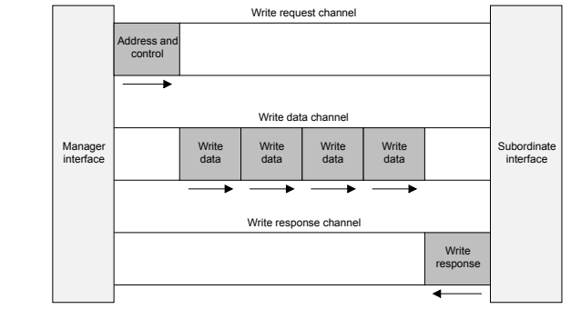
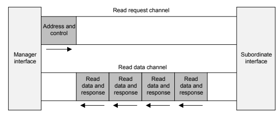
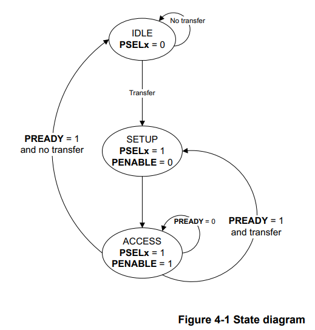

# AXI4-Lite to APB4 Bridge

## Overview
This project is a SystemVerilog implementation and verification suite for an **AXI4-Lite to APB4 Bridge** connected to a custom **APB4 Control & Status Register (CSR)** block.

In an SoC, the main system bus usually runs on AXI, while simpler peripherals like timers, UARTs, or CSR blocks run on APB to save area and power. This bridge sits between the two, translating single-beat, memory-mapped AXI4-Lite reads and writes into two-phase APB4 transfers. It preserves byte write strobes (`s_axi_wstrb` to `pstrb`), handles wait states and backpressure from either side, and translates Completer errors (`pslverr`) back to the AXI4-Lite Manager.

---

## Key Features
- **AXI4-Lite Subordinate Interface:** 32-bit address and data widths across all five independent channels (`AW`, `W`, `B`, `AR`, `R`) using standard `VALID`/`READY` handshakes on `aclk` with active-low reset (`arst_n`).
- **Decoupled Write Channels:** Independently latches the Write Address (`s_axi_awaddr`) and Write Data (`s_axi_wdata`, `s_axi_wstrb`) channels so staggered arrivals do not hang the bus.
- **APB4 Requester Interface:** Drives standard `SETUP` and `ACCESS` phases (`psel`, `penable`) with full 4-bit byte-lane write strobe (`pstrb`) support.
- **Error Handling:** Catches `pslverr` from the APB4 Completer (unmapped addresses or writes to read-only registers) and translates it to `AXI_RESP_SLVERR` (`2'b10`) on `s_axi_bresp` or `s_axi_rresp`.
- **SystemVerilog Assertions (SVA):** Bound directly to the bridge and CSR instances to monitor AXI4-Lite and APB4 protocol rules during simulation without modifying the RTL.

---

## How It Works

### AXI4-Lite Interface
All five channels use a two-way `VALID`/`READY` handshake. A transfer occurs on the rising edge of `aclk` when both signals are high:
1. **Write Address (`AW`):** `s_axi_awaddr`, `s_axi_awvalid`, `s_axi_awready`
2. **Write Data (`W`):** `s_axi_wdata`, `s_axi_wstrb`, `s_axi_wvalid`, `s_axi_wready`
3. **Write Response (`B`):** `s_axi_bresp` (`AXI_RESP_OKAY` or `AXI_RESP_SLVERR`), `s_axi_bvalid`, `s_axi_bready`
4. **Read Address (`AR`):** `s_axi_araddr`, `s_axi_arvalid`, `s_axi_arready`
5. **Read Data (`R`):** `s_axi_rdata`, `s_axi_rresp` (`AXI_RESP_OKAY` or `AXI_RESP_SLVERR`), `s_axi_rvalid`, `s_axi_rready`

In simulation, the testbench acts as the AXI4-Lite Manager.

**Write Transaction**



**Read Transaction**



### APB4 Interface
Each APB4 transfer between the Requester (bridge) and Completer (CSR) takes two clock cycles (assuming `pready = 1`):
1. **SETUP Phase (`psel = 1`, `penable = 0`):** Drives `paddr`, `pwrite`, `pwdata`, and `pstrb` onto the bus for one cycle.
2. **ACCESS Phase (`psel = 1`, `penable = 1`):** Holds all signals stable until `pready = 1`, then samples `prdata` and `pslverr`.

### Backpressure Handling
- **Response Stalls:** If the AXI4-Lite Manager holds `s_axi_bready` or `s_axi_rready` low, the bridge holds `s_axi_bvalid`/`s_axi_rvalid` and the registered payload (`s_axi_bresp`, `s_axi_rdata`, `s_axi_rresp`) stable until the handshake completes.
- **Busy Bridge:** While an APB4 transfer is in progress (`APB_SETUP` or `APB_ACCESS`), the bridge deasserts `s_axi_awready`, `s_axi_wready`, and `s_axi_arready` so incoming requests from the Manager wait cleanly.

---

## FSM Architecture
A 3-state FSM controls the APB4 Requester side of the bridge:

1. **`APB_IDLE`:** Waits for either a read handshake (`s_axi_arvalid && s_axi_arready`) or both write channels (`AW` and `W`) to be latched.
2. **`APB_SETUP`:** Asserts `psel = 1` and `penable = 0` for one cycle while driving the latched `paddr`, `pwrite`, `pwdata`, and `pstrb`.
3. **`APB_ACCESS`:** Asserts `penable = 1`. Once `pready` is high, latches `prdata` and `pslverr`, drives `s_axi_bvalid` or `s_axi_rvalid`, and returns to `APB_IDLE`.



---

## APB4 CSR Register Map
The `apb_csr.sv` Completer module is used to test reads, writes, byte strobes, and error responses end-to-end.

| Offset | Register | Access | Description |
| :--- | :--- | :--- | :--- |
| `0x00` | `CTRL` | R/W | Control register |
| `0x04` | `STATUS` | RO | Read-only status register (writes trigger `pslverr`) |
| `0x08` | `CONFIG` | R/W | Configuration register |
| `0x0C` | `TEMP` | R/W | Scratchpad register used for read/write testing |
| *Other* | *Unmapped* | N/A | Triggers `pslverr` -> translated to `AXI_RESP_SLVERR` |

---

## Verification & SVAs
The design is simulated in **AMD Vivado XSim** using a directed testbench (`bridge_tb.sv`) with clock-aligned `axi_write` and `axi_read` tasks. Both tasks take cycle-delay inputs (`w_delay`, `b_delay`, `r_delay`) to simulate AXI4-Lite Manager wait states and backpressure.

### Bound SVA Modules
- **`axi_to_apb_bridge_sva.sv` (bound to `u_bridge`):**
  - **AXI4-Lite Handshake & Payload Stability:** Verifies that once `VALID` is asserted on any channel (`s_axi_awvalid`, `s_axi_wvalid`, `s_axi_bvalid`, `s_axi_arvalid`, `s_axi_rvalid`), both the `VALID` signal and its payload (`s_axi_awaddr`, `s_axi_wdata`, `s_axi_wstrb`, `s_axi_bresp`, `s_axi_araddr`, `s_axi_rdata`, `s_axi_rresp`) remain stable until the matching `READY` handshake completes.
  - **APB4 Phase Sequencing:** Checks that `psel` transitions cleanly from `SETUP` (`penable = 0`) to `ACCESS` (`penable = 1`), and that `penable` is never asserted without `psel`.
  - **Error Translation:** Confirms that an APB `pslverr` sampled during `ACCESS` maps to `AXI_RESP_SLVERR` (`2'b10`) on `s_axi_bresp` or `s_axi_rresp`.
  - **Reset Behavior:** Ensures AXI `VALID` signals and APB control signals (`psel`, `penable`) deassert cleanly on `arst_n`.
- **`apb_csr_sva.sv` (bound to `u_csr`):**
  - **APB4 Protocol Compliance:** Verifies `SETUP`-to-`ACCESS` timing (`penable` only asserts the cycle after `psel && !penable`), checks that `paddr`, `pwrite`, `pwdata`, and `pstrb` remain stable while waiting for `pready`, and ensures `pslverr` only asserts during a valid `ACCESS` transfer (`psel && penable && pready`).
  - **Address Decoding & Access Protection:** Confirms that accesses to unmapped addresses assert `pslverr`, and that illegal writes to the read-only `STATUS` register (`0x04`) assert `pslverr` while leaving the register value unchanged.

### Directed Test Cases
1. **Zero-Delay Write/Read:** Baseline write and readback to `TEMP` (`0x0C`) with zero wait states.
2. **Staggered Write Channels:** Delays `s_axi_wvalid` after `s_axi_awvalid` and delays `s_axi_bready` to verify decoupled write latching.
3. **Backpressured Read:** Holds `s_axi_rready` low for 5 cycles to confirm `s_axi_rvalid`, `s_axi_rdata`, and `s_axi_rresp` stay stable.
4. **Unmapped Address Write:** Writes to `0x10` and verifies `s_axi_bresp == AXI_RESP_SLVERR`.
5. **Read-Only Register Write:** Attempts to write to `STATUS` (`0x04`) and verifies `s_axi_bresp == AXI_RESP_SLVERR`.
6. **Back-to-Back Recovery:** Runs a normal write and read to `CTRL` (`0x00`) right after the error tests to confirm the FSM recovers cleanly.

---

## Project Structure
```text
axi4-lite-to-apb-bridge/
├── docs/
│   ├── APB4_Operating_States.png     # APB4 operating state diagram
│   ├── AXI_Write_Transaction.png     # AXI4-Lite write transaction diagram
│   └── AXI_Read_Transaction.png      # AXI4-Lite read transaction diagram
├── rtl/
│   ├── axi_to_apb_bridge_pkg.sv      # Parameters, typedefs, and AXI response enums
│   ├── axi_to_apb_bridge.sv          # AXI4-Lite to APB4 Bridge RTL
│   ├── apb_csr.sv                    # APB4 CSR Completer
│   └── bridge_top.sv                 # Top-level wrapper
├── scripts/
│   ├── full_bridge_sim.tcl           # Full bridge Vivado XSim build and run script
│   └── run_apb_csr.tcl               # Standalone APB CSR simulation script
├── sim/
│   ├── sva/
│   │   ├── axi_to_apb_bridge_sva.sv  # Bridge protocol SVAs (bound to u_bridge)
│   │   └── apb_csr_sva.sv            # CSR SVAs (bound to u_csr)
│   └── tb/
│       ├── apb_csr_tb.sv             # Standalone APB CSR testbench
│       └── bridge_tb.sv              # Top-level directed testbench and SVA bindings
└── README.md
```

---

## How to Run
1. Clone the repo:
   ```sh
   git clone [https://github.com/migueloctavo26/axi4-lite-to-apb-bridge.git](https://github.com/migueloctavo26/axi4-lite-to-apb-bridge.git)
   cd axi4-lite-to-apb-bridge
   ```
2. Open **AMD Vivado** and `cd` into the repo directory in the Tcl Console:
   ```tcl
   cd /path/to/axi4-lite-to-apb-bridge
   ```
3. Run the full bridge simulation (or `scripts/run_apb_csr.tcl` for the standalone CSR testbench):
   ```tcl
   source scripts/full_bridge_sim.tcl
   ```
4. Check the Tcl Console for all passing test logs (with zero SVA `$error` messages) and inspect the signals in the waveform viewer.

---

## References
1. [ARM AMBA AXI and ACE Protocol Specification (AXI4-Lite)](https://developer.arm.com/documentation/ihi0022/latest/)
2. [ARM AMBA APB Protocol Specification (APB4)](https://developer.arm.com/documentation/ihi0024/latest/)